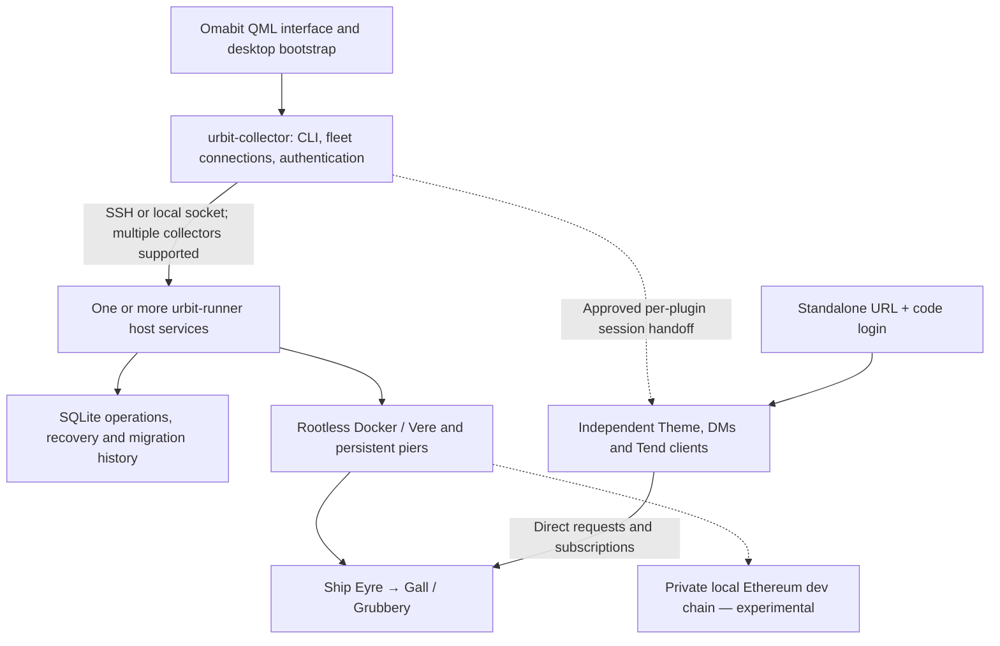

# Omabit development review — 2026-10-26

The platform goal is **paused at the user's request**, not complete. The user has
subsequently authorized one labeled [manual-review VM](manual-review-vm-2026-10-26.md);
that scoped handoff supersedes the earlier statement that no VM remains running.
No broad qualification batch has resumed. The current work is in
`/home/thelifeandtimes/repos/omabit-platform-overhaul`, branch
`codex/platform-overhaul-plan`, based on `b233128`. It has not been released or
installed over the user's plugins. The isolation exclusions remain in force:
managed `~lismyl-lismyl`, tmux ships, `~/temp-ur`, installed plugins and production
services are outside this work.

## Storage cleanup

| Directory under `~/Documents/ChatGPT` | Before | After |
| --- | ---: | ---: |
| `omabit-qualification-evidence` | 294.73 GiB | 13.47 GiB |
| `omabit-private-docker-labs` | 84.21 GiB | 16.91 GiB |
| Total | 378.94 GiB | 30.38 GiB |

Removed 382 explicitly inventoried generated files, accounting for 348.56 GiB of
reported allocation: superseded VM disks, disposable native pier checkpoints/event
data, duplicate pills/initramfs images and generated test binaries. This is a
92% reduction in the two directory trees. These are `du` allocated-size figures,
not a measured filesystem-wide free-space delta; sharing and unrelated activity
can make those differ.

**Correction discovered during subsequent manual-VM preparation (M448):** the
shared raw base was reached through a symlink chain into the cleanup root, and its
actual target was deleted. The three retained overlays are not currently bootable
complete archives. The earlier claim that every required base/input was preserved
was incorrect. Reports, source records and overlay bytes remain; no recovery is
claimed. Future retention must validate resolved backing-file dependencies.

Retained three VM overlay files: M352's passing official keyed Docker reference,
M442's specific observation-failure trace, and M443/M446's latest ordinary failure.
Current build/module cache, historical source fixtures, source snapshots, reports
and small manifests remain; see the dependency correction above. In particular,
`2026-10-25-private-docker-code-cache` is the active shared cache, so it was kept.
The `/tmp` alias survived, but its resolved backing data did not. VM tooling remains.

The exact inventory and result are in
[the storage review evidence](/home/thelifeandtimes/Documents/ChatGPT/omabit-qualification-evidence/2026-10-26-storage-review/cleanup-result.json).
Every affected old bundle has a `BULK_DATA_PRUNED_2026-10-26.txt` note: it is now
historical metadata/source, not a complete runnable archive. Two guarded attempts
stopped first (unsupported `fuser` syntax, then read-only generated directories);
the final continuation verified all removals and restored directory modes.
No Docker prune, broad directory deletion or production operation was used.

## 1. What is completed, and what remains

These are demonstrated development checkpoints, not a claim that the corresponding
whole roadmap step or current combined branch is release-qualified.

| Area | Implemented or demonstrated | Remaining |
| --- | --- | --- |
| Pier imports | Specific rejection diagnostics; identity-based child layout; interrupted-copy restoration and re-import; guided UI through real collector/runner in disposable VMs | Remaining failure/upgrade cases and an end-user native walkthrough. The user's original running pier was not diagnosed or touched. |
| CLI and skills | Task-oriented help, structured errors, project commands, operator/developer guidance | Human usability review and release integration |
| Fake projects | Two-ship messaging, persistent application state, subscription recovery, container replacement, duplicate identities in separate projects, published endpoints and coordinated lifecycle recovery | Mutating project UI and final combined release qualification |
| Theme and DMs | Independent per-plugin sessions, assisted and standalone login, direct plugin-to-Eyre data; copied native plugins exercised through desktop/package recovery | Broader real-backend/hosted-ship tests, locked-keyring/reboot behavior and installed-user rollout. Native repeated-session proof used synthetic Eyre and a private compositor. |
| Backend installation | Plugin-owned installation/compatibility pattern and standalone Tend proof; discovery remains with Omart | Broader publisher/update-order coverage and full native UX |
| Developer kit | Isolated collection/profile mechanisms; official keyed private-chain peers pass application-state and subscription recovery in standalone native/Docker fixtures | Easy public stable/dev/edge switching; managed private-devnet ship lifecycle remains unfinished |

The current blocker to completing private devnets is **managed member startup**.
Gateway initialization/recovery passed, but the ordinary managed ship launch was
interrupted after Start. A separate diagnostic run located a post-capture gateway
observation deadline. The source now records the first-boot pier binding before
later observation, so an observation failure need not lose that binding.

That schema46 change is integrated, with 197 focused admission/queue/HTTP race
checks passing. Earlier staged storage and adapter checks also passed. The broader
integrated batch recorded 2,878 passing test/subtest events, then hit its 300-second
harness timeout in an existing runtime test. This is **not a full-suite pass**;
remaining integrated migration/auditor/build gates and a fresh runtime proof did
not run. No schema46 VM was launched. See M447 in
[development memory](development-memory.md).

Wallet work remains research notes: ordinary Eyre sessions and unsandboxed plugins
running as the same desktop user are not a wallet key-isolation boundary.

## 2. What is working well

- Disposable runtime and desktop boundaries have preserved the user's working setup.
- Tests exercise actual persistent state, subscription recovery, lost replies and
  restart behavior, with separate read-only evidence checks.
- Upgrade checks use real frozen historical writers and preserve old databases;
  they do not substitute newly generated lookalike fixtures.
- Product boundaries remain clear: Omabit assists authentication, plugins own
  direct data connections and fallback login, and Omart owns discovery.
- Numbered memories distinguish evidence, hypotheses and superseded conclusions.

## 3. What needs to improve

I let the verification machinery and retained history grow too far ahead of a
reviewable user experience. The disk growth and unusually large uncommitted branch
are development-process failures, even though individual checks were careful.
At the inventory point there were 70 changed tracked files and 1,254 untracked
entries; those counts include documents and tooling, not just product code.

The next development phase should use:

- A 40 GiB retained-evidence budget across the two roots, including shared caches;
  one active runtime experiment, with an explicit additional scratch estimate.
  Keep one passing reference and current diagnostic failures (three retained VM
  disks maximum by default), then prune superseded generated payloads. Preserve
  compact results, source identity, relevant traces and migration fixtures.
- Shared immutable bases, pills and caches; no full bundle copy for each source
  helper or read-only inspection. Measure storage before and after runtime work.
- Narrow source checks first, bounded integration batches next, and a VM only for
  behavior that requires one. Fix the timed-out test batch before treating it as
  a repeatable gate; do not repeatedly rerun thousands of unrelated checks.
- Small reviewable changes and deliberate commit/release boundaries. Batch related
  persistence changes around a coherent feature contract.
- A separately labeled manual-review build after a visible feature works, before
  more backend expansion. Keep a concise current-state page above the historical
  chronology and review against “Multiplayer apps without a subscription.”

The retention rule is recorded now. Automatic enforcement in the experiment
launcher remains future implementation; no new launcher work was started while
paused.

## 4. What to check manually

Use only fresh disposable ships and a separate experimental desktop/VM.

| Flow | Human acceptance check |
| --- | --- |
| Import | Can you understand the exact rejected entry and repair the source safely? Does preview show `<instance>/<ship>`? Does interrupted-copy recovery clearly preserve the original and avoid an accidental second start? |
| Fleet/project UI | Is the selected runner/ship unambiguous? Can you distinguish saved history, current health and an uncertain operation? |
| Theme/DMs connection | Is approval clear about plugin, profile and ship? Can each log in standalone? Does disconnecting one leave the other working? Do subscriptions recover without stale account data? |
| Missing backend | Is the missing desk/app explained, with an install button naming its publisher and a useful readiness result? |
| Profiles | Are stable/dev labels obvious? Do credentials, settings, theme effects, hooks and notifications stay in the intended experimental desktop? |

The original valuable-pier import, real personal messages and production theme
changes are not needed for this first review.

## 5. Code size and architecture

Counted the current Omabit development checkout, including uncommitted files;
excluded generated/vendor copies, `testdata`, test fixtures, documentation and the
separate Theme/DMs/Tend repositories. These are physical source lines, including
comments and blank lines, with approximate implementation/test classification.

| Category | Files | Lines |
| --- | ---: | ---: |
| Implementation and tools | 611 | 100,164 |
| Tests and qualification harnesses | 826 | 144,032 |
| Total | 1,437 | 244,196 |

Of the total, 189,678 lines are Go, 44,667 Python, 6,023 QML, 3,328 JavaScript,
452 shell and 48 Hoon. The implementation/tools bucket includes 20,320 lines in
`internal/runtimequalify`; it is not solely shipped UI/product logic. Per-file
counts and method are saved in the storage review's `code-size.json`.



`native/` hosts desktop loading/profile mechanisms; `plugins/omabit/` contains
QML; `cmd/omabit` is the desktop helper. `backend/cmd/` contains collector/runner
entry points. `internal/managed` owns durable operations and migrations;
`projectnetwork`, `privatechain`, `pierstore` and runtime adapters implement the
host behavior. A runner continues without an Omarchy desktop. Hosted ships can
serve clients without an Omabit runner. Omart is separate discovery infrastructure.

## 6. Manual next steps

**Immediately:** review the status/diagram and try the offline CLI walkthrough
below if you want to inspect the new guidance. It does not select or contact a
runner, start ships, install a plugin or change the active desktop. This is a
source-build walkthrough, not a signed or release-qualified package.

Run from a terminal, reusing the retained Go cache without downloading modules:

```bash
cd /home/thelifeandtimes/repos/omabit-platform-overhaul
review_dir=$(mktemp -d /tmp/omabit-manual-review.XXXXXX)
env GOCACHE=/tmp/omabit-go-build GOMODCACHE=/tmp/omabit-go-mod \
  GOPROXY=off GOSUMDB=off GOTOOLCHAIN=local \
  go build -o "$review_dir/urbit-collector" ./backend/cmd/urbit-collector
```

If that build fails, stop and retain the error; do not install dependencies or
switch the active plugin to work around it. After a successful build:

```bash
review_cli() {
  env -i PATH=/usr/bin:/bin HOME="$review_dir" \
    XDG_CONFIG_HOME="$review_dir/config" XDG_STATE_HOME="$review_dir/state" \
    XDG_DATA_HOME="$review_dir/data" XDG_CACHE_HOME="$review_dir/cache" \
    "$review_dir/urbit-collector" --config-dir "$review_dir/collector" "$@"
}
review_cli --format text help
review_cli --format text help imports
review_cli --format text help connections
review_cli --format text help projects
review_cli --format text project-plan --label manual-review \
  --member review-zod:~zod:18381 --member review-nec:~nec:18382 \
  --shared-administration
```

The last command should report an offline plan with no resources reserved or
started. Check whether the wording tells you what happens next without reading
implementation details. The commands were checked against source here; this pause
review did not run a new build or test batch.

**Next interactive milestone, after we resume:** produce one separately labeled,
size-bounded review bundle and disposable desktop/runner VM. Walk through fake
ship creation, stopped disposable-pier import/recovery, then Theme/DMs connection
and independent logout. A simple current-branch end-user review bundle is not yet
prepared. Do not use a normal plugin update or the stock bootstrap's `select`
command to try this branch: that would affect the active installation. Private
managed devnet startup should remain out of this initial walkthrough until its
failure and incomplete integration checks are resolved.
