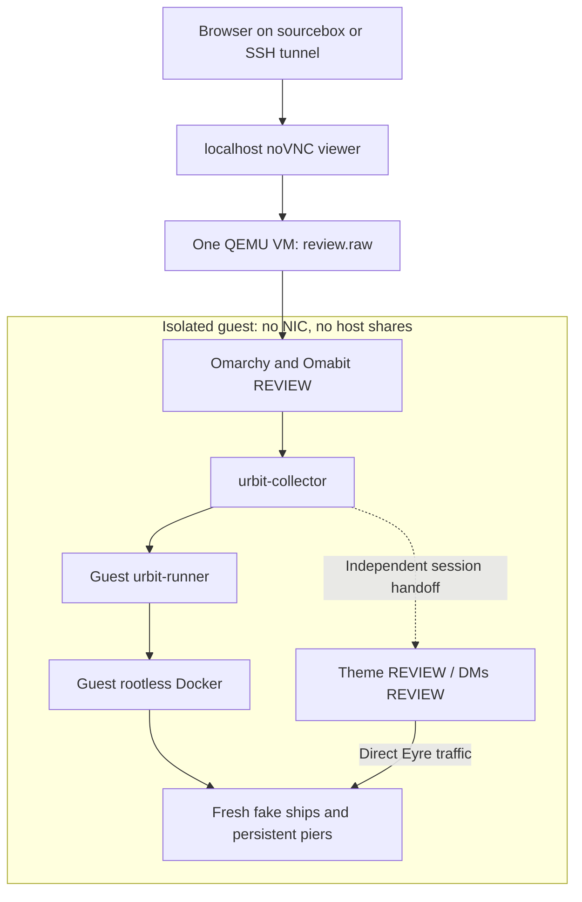

# Omabit manual review VM — 2026-10-26

For a fresh first-use flow running locally on sourceport or another Omarchy machine, use the [portable onboarding VM](portable-onboarding-vm-2026-10-26.md). The original preconfigured review VM described below is preserved separately and currently stopped.

This is the user-requested isolated review build. The broader automatic roadmap remains paused. One persistent VM contains copies of Omabit, Network Theme and Urbit DMs with `.review` IDs. No installed host plugin or production ship is part of this VM.

## Open the desktop

On **sourcebox**, run:

```sh
python3 -B ~/Documents/ChatGPT/omabit-private-docker-labs/manual-review-20261026-01/review-vm.py start
```

Open **http://127.0.0.1:6081/vnc.html?autoconnect=1&resize=scale** in a browser on sourcebox. Enter VNC password **review26**. The guest logs in automatically as **review**; its guest-only password is **omabit-review**. No libvirt or virt-manager installation is required.

From a different computer, use your normal SSH access to sourcebox with this local-only forwarding:

```sh
ssh -N -L 6081:127.0.0.1:6081 sourcebox
```

Then open the same URL on that computer. Keep the SSH session running. If local port 6081 is already occupied, use `-L 6082:127.0.0.1:6081` and browse port 6082 instead. The VM itself has no NIC; this forwards the host viewer, not guest networking.

Allow roughly five minutes for the desktop and ship to settle after a cold VM start. Click the desktop before typing. F2 opens a guest terminal, F3 opens the walkthrough, F4 opens Omabit, F6 expands/restores the focused window, F7 opens the full DMs panel, and Alt+Tab switches guest windows. The noVNC handle on the left has Full screen and scaling settings. Avoid host Super-key shortcuts; the F-key shortcuts do not need them. On laptops, use Fn if your F-keys are media keys.

The walkthrough opens in guest Chromium. It contains the exact steps, expected results, scope limits, per-section review status, persistent notes and a feedback export button. Notes are kept in this guest browser; they are not automatically sent anywhere. Do not include credentials in feedback. Guest application clipboard copy/paste works within the desktop; no host/guest clipboard bridge is configured.

## Review order

1. Confirm REVIEW labels, version `0.2.0-review.20261026`, local `review-vm` runner and healthy `review-zod / ~zod`.
2. Stop and restart ~zod. Check operation history and persistent identity. Use its **Copy +code** control for the later login steps.
3. Inspect `/home/review/import-source/unclassified-pier`. One deliberate `review-link` symlink should trigger a specific rejection. Remove **only that link in the guest terminal**, inspect again, then import the stopped ~nec. Expect `/srv/urbit/piers/fakeships/nec/nec`; import leaves it stopped. Start is separate. This is a move, and the source is not regenerated automatically.
4. Inspect fake creation and maintenance forms. Do not launch additional downloads in this offline build. Optionally Pack the stopped imported fake; defer destructive/history-changing maintenance for a separate fixture.
5. In Setup → Application Connections, add `review-zod`, URL `http://127.0.0.1:8080`, ship `~zod`. Sign in using Copy +code. Approve Theme and DMs independently, checking `.review` IDs and `review` profiles. Disconnect one and check that the other retains its sign-in.
6. Finish removing assisted attempts before trying each plugin's own URL/+code sign-in. This verifies the standalone path without requiring Omabit as a data provider.
7. Stop/restart ~zod and review visible connection/session recovery. Full %groups state/subscription recovery needs a prepared application backend fixture.
8. Save notes, optionally export feedback, stop the VM, then reopen the same disk.

## Current fixture limits

The pinned core pill is not a prepared %groups/Tlon application fixture. Authentication, owner-session consent and missing-backend/error presentation are the intended connection review; actual DM delivery, theme exchange and backend install completion are deferred. Offline web asset requests can log HTTP 504/docket retries while the ship is healthy. Do not treat the absence of a fetched Landscape/webterm page as a runner failure.

Private Ethereum devnet startup remains unfinished. Project networking is currently a read-only saved-history UI. Easy stable/dev/edge collection switching, remote/hosted ship flows, package/update downloads, wallet security and interrupted cross-filesystem import restoration are not qualified here. No real keys or existing piers are needed.

## Stop and resume

Run these on **sourcebox**, outside the guest:

```sh
python3 -B ~/Documents/ChatGPT/omabit-private-docker-labs/manual-review-20261026-01/review-vm.py status
python3 -B ~/Documents/ChatGPT/omabit-private-docker-labs/manual-review-20261026-01/review-vm.py stop
```

Close the guest Chromium window after saving notes if you want to avoid its restore-pages notice on the next boot. Stop requests a guest shutdown. Wait until status is inactive before starting again. Closing the browser only disconnects its viewer. Starting an already-running VM returns its viewer URL; it does not create a second VM. The start command resumes the same disk, preserving piers, sessions, imports and notes. There is deliberately no automatic reset/recreate command.

## Structure and storage



The self-contained sparse raw disk has a 16 GiB virtual capacity and **no backing files**. VM limits: 10 GiB guest RAM, 12 GiB host process limit with no swap, 4 virtual CPUs and a 300% host CPU quota. Sourcebox exposes neither KVM nor a GPU, so this uses software emulation. Initial boot and first ship boot are slower than production; this is not a performance benchmark.

The host controller monitors the two experiment roots against a 40 GiB allocation budget and bounds its logs. It shuts this VM down if that budget is exceeded. It does not prune other files. Keep using this one disk. Build inputs/hashes, a small guest-only graphics patch and retained logs are beside it. The guest-only Aquamarine patch uses its existing GBM renderer path to support software graphics; the installed host graphics stack is unchanged.

Guest paths: plugins at `~/.config/omarchy/plugins/*review`; managed piers at `/srv/urbit/piers`; stopped import fixture at `/home/review/import-source`; guide/tools/pinned inputs at `/opt/omabit-review`. The guest keyring starts unlocked; locked-keyring recovery is a later review item. Omabit's default profile exists only inside the guest; Theme and DMs use profile `review`.

## If something is confusing or fails

Wait for the current operation to settle rather than clicking again. Capture the section number, visible message, expected result and screenshot. F3 reopens the guide. If the viewer disconnects, check the host status command and `run/last-exit.json` / `run/qemu.log`; do not rebuild a new image or prune data. Ask this task to inspect the existing review VM if needed.

See also [the overall development review](/home/thelifeandtimes/repos/omabit-platform-overhaul/docs/development-review-2026-10-26.md). The earlier archive-base preservation claim was corrected in M448; this review image has no dependency on those incomplete historical overlays.

## Handoff verification

The host stop command completed a clean guest shutdown (QEMU exit 0). Restarting the same disk restored the same runner ID, ~zod identity, pier path and configuration revision, and ~zod returned to healthy. The ~nec import source and its intentional rejection link survived. Desktop shortcuts and the REVIEW DMs sign-in panel were visually checked. Hyprland reports no configuration errors. Actual application logins and reviewer feedback remain for your manual pass.
